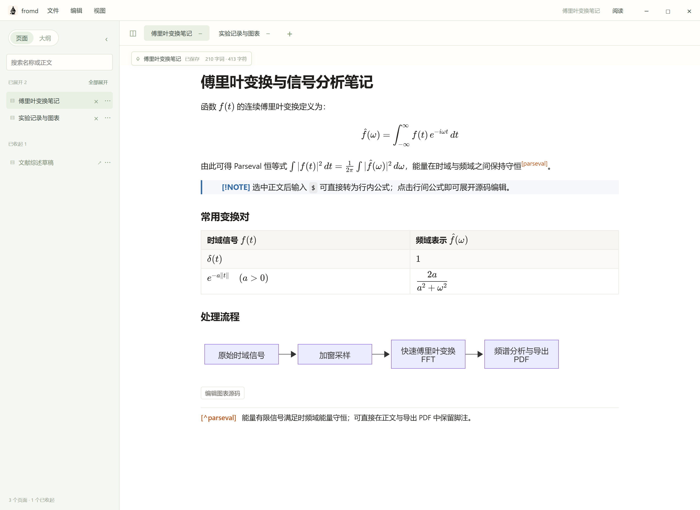

# fromd

> A calm, local-first WYSIWYG Markdown & math writing app — click `+` to write instantly, rename without saving files, and shelve inactive pages out of sight.

[](https://github.com/frowang-ai/fromd/releases/latest)
[](LICENSE)
[](https://github.com/frowang-ai/fromd/releases)
[](https://github.com/frowang-ai/fromd/releases/latest)
[](https://v2.tauri.app)
[](https://github.com/frowang-ai/fromd/stargazers)

🌐 **[简体中文](README.md) · English**

[**Download Latest (v0.5.2)**](https://github.com/frowang-ai/fromd/releases/latest) · [**Three Pillars**](#three-pillars) · [**Comparison**](#compared) · [**Install & Update**](#install--in-app-update) · [**Build from Source**](#build-from-source) · [**FAQ (ZH)**](docs/faq.md) · [**Changelog (ZH)**](CHANGELOG.md) · [**Issues**](https://github.com/frowang-ai/fromd/issues/new/choose)

⭐ **If `fromd` earns a place on your desktop, please [star it on GitHub](https://github.com/frowang-ai/fromd) — it is free, MIT-licensed, and stars help other writers and researchers find it.**



Most Markdown editors interrupt a new thought by asking where to save a `.md` file first—and days later, your tab bar is crowded with half-finished drafts you don't want to close. **fromd removes file-management friction before and after you write**: click `+` to start a new page immediately, rename drafts directly in place without creating files on disk, let every keystroke persist to local SQLite, and click `−` on any tab to shelve inactive notes into the background sidebar until you need them again.

Built on **Tauri 2 + Vue 3 + Milkdown (ProseMirror) + SQLite + Rust**. ~6.3 MB installer on Windows, ~9.1 MB on macOS. **MIT-licensed, zero accounts, zero subscriptions, zero cloud relay, zero telemetry** — your drafts, images, and reading preferences stay strictly on your machine.

## Three pillars

1. **Zero-friction drafts & one-click page shelving.** Click `+` to open a fresh Markdown page immediately. Rename unsaved drafts directly above the document; body text, titles, and reading scroll positions stream continuously to local SQLite with IME-safe close handshakes. Click `−` on any tab to shelve pages out of the top bar into the **Shelved** list and restore them anytime in one click.
2. **Calm WYSIWYG & first-class math authoring.** Write directly in clean rendered prose, tables, code blocks, formulas, and diagrams without split-pane clutter—or press `Ctrl+/` (`⌘/` on macOS) anytime to toggle full raw Markdown source (unmodified files preserve exact literal spelling and comments). Edit inline and centered display KaTeX formulas in place, select text and press `$` to wrap as math (or `*`, `_`, `~`, `` ` ``, brackets/quotes to wrap styles), and paste `.tex` snippets from VS Code with automatic math delimiter recognition.
3. **Offline diagrams, full-text search & native A4 PDF export.** Render Mermaid diagrams (`flowchart`, `sequenceDiagram`, `classDiagram`, `gantt`, `mindmap`, etc.), footnotes, and all 5 GitHub Alerts (`NOTE`, `TIP`, `IMPORTANT`, `WARNING`, `CAUTION`) 100% offline. Paste screenshots or drag images into a SHA-256 deduplicated local store (`Save As` automatically copies referenced local images alongside your `.md`). Export multi-page A4 PDFs (18 mm margins) natively with zero external Pandoc or LaTeX setup.

| Feature | What it does |
| --- | --- |
| **WYSIWYG + Raw Source Toggle** | Clean rendered editing with instant `Ctrl+/` (`⌘/`) source switching, per-page undo history, and lossless round-trips on untouched files. |
| **Instant Drafts & Live Rename** | Click `+` to write right away and rename drafts without touching disk dialogs; export to `.md` via `Ctrl+S` / `⌘S` only when you want to. |
| **Tab Shelving (`−`)** | Shelve individual, other, or all tabs to the sidebar background list to keep your workspace focused; drag to reorder and undo page removal. |
| **KaTeX Math & Selection Wrap** | Live inline math preview, click-to-edit display blocks, `\tag{...}` numbering, `$` / `*` / `_` / `~` / bracket wrapping, and VS Code `.tex` paste support. |
| **Offline Mermaid, Footnotes & Alerts** | Bundled Mermaid SVG diagrams, multi-paragraph footnotes (`[^id]`), and GitHub Alerts rendered identically on screen and in exported PDFs. |
| **Managed Local Images & Attachments** | Paste screenshots from clipboard or drag files in; content-addressed local storage with document-scoped protocol isolation. |
| **Full-Text Search & Find/Replace** | Search across all open and shelved SQLite drafts from the sidebar; in-document Find & Replace (`Ctrl+F` / `Ctrl+H` / `⌥⌘F`) with `Aa` case matching. |
| **Outline, Counts & Reading Theme** | Switch sidebar between Pages and Heading Outline; live CJK + word/character counts; font size (14–20 px), width (720–1080 px), Light / Dark / System theme, and 50%–200% zoom. |
| **Native A4 PDF Export & Import** | True paginated A4 PDF export via Windows WebView2 `PrintToPdf` and macOS AppKit `NSPrintOperation`; import `.txt` and `.html` with relative images. |
| **Guarded Manual Updates** | Check for updates on demand; Windows verifies `SHA256SUMS.txt` and flushes IME/SQLite drafts before launching an in-place NSIS overwrite upgrade. |

## Compared

| | **fromd** | Typora | Obsidian | Split-pane Editors |
| --- | --- | --- | --- | --- |
| **License** | **MIT (Open Source, Free)** | Proprietary ($14.99) | Proprietary (Paid Sync) | Varies |
| **Stack & Installer Size** | **Tauri 2 + Rust (~6 MB Win / ~9 MB Mac)** | Native / Hybrid | Electron (~110 MB) | Mostly Electron (70–120 MB) |
| **WYSIWYG + Raw Source** | **✅ Both (`Ctrl+/` / `⌘/`)** | ✅ | 🟡 Live Preview | ❌ Split panes |
| **Write & Rename Without Creating `.md` First** | **✅ Automatic SQLite drafts** | 🟡 File-backed | ❌ Vault file required first | ❌ File-backed |
| **One-Click Tab Shelving to Background** | **✅ Built-in (`−` on tabs)** | ❌ | ❌ | ❌ |
| **Selection `$` Math Wrap & `.tex` Paste** | **✅ Built-in** | 🟡 Basic math blocks | 🟡 Community plugins | ❌ Manual delimiters |
| **Zero-Pandoc Paginated PDF Export** | **✅ Built-in (Math + Mermaid + Alerts)** | ✅ Built-in PDF | ✅ Basic PDF | 🟡 Often loses diagrams |

## Install & in-app update

Download the latest release (**v0.5.2**) from [**GitHub Releases**](https://github.com/frowang-ai/fromd/releases/latest):

| Platform | Package | Notes |
| --- | --- | --- |
| **Windows 10 / 11 (x64)** | `fromd_<version>_x64-setup.exe` | Per-user NSIS installer (no admin required), custom install directory supported; bootstraps WebView2 if missing |
| **macOS Apple Silicon (M series)** | `fromd_<version>_aarch64.dmg` | Also called ARM64; macOS 11.0+; `.app.zip` also provided |
| **macOS Intel (x64)** | `fromd_<version>_x64.dmg` | macOS 11.0+; `.app.zip` also provided |

For a MacBook Air, check **Apple menu → About This Mac**: **Apple M-series → aarch64 (ARM64)**; **Intel → x64 (x86_64)**. Verify the download against `SHA256SUMS.txt` from the same official Release. Open the DMG, drag `fromd.app` into **Applications**, wait for the copy to finish, eject the DMG, then open `/Applications/fromd.app`.

The published **v0.5.2** packages were distributed as **unsigned**, and macOS packages are **not notarized**. The repository now configures free **ad-hoc signing for future builds; this change has not been released**. Ad-hoc signing checks content integrity after signing; it is not Developer ID signing, Apple notarization, or a guarantee that Gatekeeper will allow launch.

If macOS cannot verify the developer, verify the source and hash, then use **System Settings → Privacy & Security → Open Anyway** if available. A **“damaged”** message can also indicate a corrupt download or invalid signature: re-download, verify, and reinstall first. If the same message persists and you trust the verified app, the [installation guide](docs/install-macos.md#第一次打开) explains the optional, manual `xattr -dr com.apple.quarantine "/Applications/fromd.app"` command. It removes only this app's quarantine attribute, does not disable Gatekeeper globally, and cannot repair real corruption or an invalid signature. Stop and report a malware warning or persistent failure.

Guides: [Windows Install (ZH)](docs/install-windows.md) · [macOS Install (ZH)](docs/install-macos.md) · [FAQ (ZH)](docs/faq.md).

**Manual In-App Updates:** `fromd` never checks for updates silently in the background. Use **File → 检查更新…** (Windows) or **fromd → 检查更新…** (macOS) to check on demand. On Windows, clicking **立即更新** verifies the SHA-256 checksum, waits for active IME input and flushes all SQLite drafts (`wal_checkpoint(FULL)`), then launches the NSIS installer in place while preserving 100% of your existing notes, shelved pages, images, and preferences.

## Privacy & security

100% offline during daily writing. Editor bundles, KaTeX fonts, and Mermaid live inside the app—zero CDN requests, zero analytics. Network requests happen only when you explicitly click **Check for Updates**, strictly pinned to HTTPS 443 GitHub Release allowlists. Document images use a custom `frowd-resource` protocol that enforces per-document ownership and raster header validation.

## Build from source

Prerequisites: **Node.js 22.19+**, **Rust 1.93.1**, MSVC Build Tools + Windows SDK (Windows) or Xcode Command Line Tools (macOS).

```sh
git clone https://github.com/frowang-ai/fromd.git
cd fromd

npm ci --ignore-scripts
npx --yes pnpm@10.11.0 --dir apps/tauri install --frozen-lockfile

npm run dev                   # launch native Tauri dev client
npm run tauri:installer:win   # build Windows x64 NSIS installer
npm run tauri:installer:mac   # build macOS APP + DMG
```

Architecture & test suites: **[docs/development.md](docs/development.md)**.

## License & credits

**[MIT License](LICENSE)** © Frowang contributors.

Built with Tauri 2, Vue 3, Milkdown / ProseMirror, CodeMirror 6, markdown-it, KaTeX, and Mermaid. Tauri desktop foundation and prose typography adapted with gratitude from [SoloMD](https://github.com/zhitongblog/solomd) (v5.0.21, MIT). See **[THIRD_PARTY_NOTICES.md](THIRD_PARTY_NOTICES.md)** and **[apps/tauri/THIRD_PARTY_NOTICES.md](apps/tauri/THIRD_PARTY_NOTICES.md)**.
