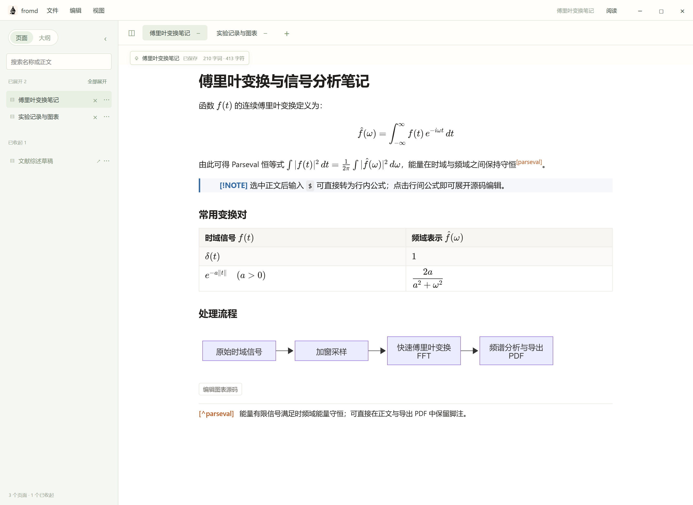

# fromd

> 所见即所得、零文件管理负担的本地 Markdown 写作工具 —— 点 `+` 即开新页、无需存盘直接改名与实时保存、不看的页面一键收起到后台。

[](https://github.com/frowang-ai/fromd/releases/latest)
[](LICENSE)
[](https://github.com/frowang-ai/fromd/releases)
[](https://github.com/frowang-ai/fromd/releases/latest)
[](https://v2.tauri.app)
[](https://github.com/frowang-ai/fromd/stargazers)

🌐 **简体中文 · [English](README.en.md)**

[**下载最新版 (v0.5.2)**](https://github.com/frowang-ai/fromd/releases/latest) · [**三大核心体验**](#三大核心体验) · [**定位对比**](#与其他工具的定位对比) · [**安装与更新**](#下载安装与应用内更新) · [**从源码构建**](#从源码构建) · [**常见问题**](docs/faq.md) · [**版本记录**](CHANGELOG.md) · [**提交反馈**](https://github.com/frowang-ai/fromd/issues/new/choose)

⭐ **如果 fromd 在你的日常写作、论文草稿或公式推导中帮到了你，欢迎点一颗 [Star](https://github.com/frowang-ai/fromd) —— 免费 MIT 开源，你的支持能让更多需要它的人看到。**



很多 Markdown 编辑器在你刚冒出一个念头时，第一件事是弹窗让你选文件夹、起文件名；写上几天，窗口顶栏又塞满十几篇舍不得关的临时草稿。**fromd 把动笔前后的文件管理琐事全部拿掉**：点 `+` 立刻开写，不存成 `.md` 文件也能直接在正文左上方改名，草稿与阅读进度实时写入本地 SQLite；暂时不看的页面点 `−` 一键收进左侧后台列表，随用随取；同时给你安静顺手的所见即所得排版、KaTeX 公式原位编辑、Mermaid 离线图表与原生 A4 分页 PDF 直出。

基于 **Tauri 2 + Vue 3 + Milkdown (ProseMirror) + SQLite + Rust** 构建。Windows 安装包约 **6.3 MB**，macOS 安装包约 **9.1 MB**。MIT 开源、无账号、无订阅、无云端中转、无遥测——你的所有文稿、图片附件与阅读设置都只留在自己的电脑上。

## 三大核心体验

1. **即点即写与无负担页面收起。** 点顶部 `+` 立即新建 Markdown 页面动笔，无需提前选路径建文件；未落盘草稿可直接在正文左上角重命名，正文、标题与滚动位置持续保存在本地 SQLite 数据库（内置输入法组合态等待与关闭落盘握手，意外中断或重启后内容仍在）；暂时不看的页面点标签 `−` 一键收起到左侧「已收起」列表，顶栏始终保持清爽，需要时点击即可恢复。
2. **纯粹所见即所得与中文公式写作。** 正文直接呈现标题层级、列表、表格、代码高亮、公式与图表效果，无需左右分屏，随时按 `Ctrl+/`（macOS `⌘/`）一键切换完整 Markdown 源码（未编辑的原文严格保留字面拼写与注释）；行内与居中行间 KaTeX 公式支持原位编辑、`\tag{...}` 编号与空公式占位；选中文字输入 `$` 直接转为行内公式，输入 `*` / `_` / `~` / 反引号 / 括号自动包裹，从 VS Code 粘贴 `.tex` 源码自动识别数学公式。
3. **离线图表扩展、全库搜索与开箱 PDF 直出。** 内置离线 Mermaid 矢量图表渲染（流程图、时序图、类图、甘特图、思维导图等，点击即可展开图表源码编辑）、标准脚注与五类 GitHub 提示块（`NOTE` / `TIP` / `IMPORTANT` / `WARNING` / `CAUTION`）；截图直接粘贴、文件拖入由本地 SHA-256 内容寻址资源库统一管理，另存为 `.md` 时自动将关联本地图片复制到目标相对路径；无需配置外部 Pandoc 或 LaTeX 环境，原生直出 A4 多页 PDF（18 mm 页边距）。

| 功能模块 | 具体能力 |
| --- | --- |
| **所见即所得 + 源码往返** | 正文直观编辑，随时按 `Ctrl+/`（`⌘/`）切换完整 Markdown 源码；独立按页撤销历史，未改文档原样保留格式。 |
| **免存盘开写与重命名** | 点 `+` 立即可写，未存 `.md` 也可直接改页面标题；本地 SQLite 持续保存，真正需要导出文件时再按 `Ctrl+S` / `⌘S`。 |
| **标签收起与多页管理** | 标签页点 `−` 收进左侧「已收起」分组，右键支持收起其他 / 收起全部 / 全部展开，支持标签拖拽排序与关闭撤销。 |
| **公式原位编辑与快捷包裹** | KaTeX 行内实时小预览、行间公式点击展开源码；选中文本按 `$` 变公式，按 `*` `_` `~` `` ` `` `(` `[` `{` `"` 自动包裹；识别 `.tex` 粘贴。 |
| **Mermaid 图表与扩展语法** | 100% 离线打包 Mermaid 图表、多段标准脚注（`[^id]`）与五类 GitHub Alerts 彩色提示块，正文与导出 PDF 表现一致。 |
| **截图粘贴与附件管理** | 剪贴板截图直粘、图片与附件拖入，按文档归属校验安全隔离；另存为 `.md` 时自动拷贝引用的本地栅格图片。 |
| **全文搜索与查找替换** | 侧栏跨全部页面（含未落盘草稿与已收起页面）搜索正文与标题；文档内 `Ctrl+F` / `Ctrl+H`（macOS `⌥⌘F`）支持 `Aa` 区分大小写替换。 |
| **大纲、统计与阅读主题** | 侧栏「页面 / 大纲」一键切换跳转；实时中日韩字词与字符统计；支持字号（14–20 px）、行宽（720–1080 px）、浅色 / 深色 / 跟随系统主题及 50%–200% 页面缩放。 |
| **原生 A4 PDF 导出与导入** | Windows WebView2 `PrintToPdf` 与 macOS AppKit `NSPrintOperation` 原生分页导出；支持 TXT / HTML 文档连同相对图片安全导入。 |
| **手动检查与覆盖更新** | 菜单点击「检查更新…」，左下角轻量弹窗提示；Windows 自动校验 SHA-256、保存未完输入后一键覆盖更新并 100% 继承数据库。 |

## 与其他工具的定位对比

fromd 专注于把「随手开写、公式推导、干净排版、导出分享」这一件事做到极致轻快，不去堆砌复杂的双链图谱或账号体系：

| 对比维度 | **fromd** | Typora | Obsidian | 传统双栏编辑器 |
| --- | --- | --- | --- | --- |
| **开源与价格** | **MIT 开源免费** | 商业付费 ($14.99) | 闭源免费（同步付费） | 视具体工具而定 |
| **桌面技术栈与体积** | **Tauri 2 + Rust（Win ~6 MB / Mac ~9 MB）** | Electron / 原生混合 | Electron（~110 MB） | 多为 Electron（70–120 MB） |
| **所见即所得体验** | **✅ 纯正所见即所得 + 一键切源码** | ✅ 所见即所得 | 🟡 实时预览为主 | ❌ 左右分屏占空间 |
| **点 `+` 免建文件直接写 / 改名** | **✅ 本地 SQLite 自动持久化草稿** | 🟡 需保存文件落盘管理 | ❌ 需先在库内创建 `.md` 文件 | ❌ 通常依赖外部文件保存 |
| **不看的页面收起到后台** | **✅ 标签 `−` 一键收起，随点随恢复** | ❌ 关闭即退出标签 | ❌ 关闭标签需重新检索打开 | ❌ 无收起工作流 |
| **公式选区 `$` 包裹与 `.tex` 粘贴** | **✅ 原生内置** | 🟡 基础公式块与行内公式 | 🟡 需装社区插件增强 | ❌ 多仅支持手写分隔符 |
| **免 Pandoc 多页 PDF 导出** | **✅ 内置原生分页（含公式/Mermaid/提示块）** | ✅ 内置 PDF（其他格式需 Pandoc） | ✅ 基础 PDF 导出 | 🟡 常缺失图表或样式走样 |

## 下载安装与应用内更新

前往 [**GitHub Releases**](https://github.com/frowang-ai/fromd/releases/latest) 下载最新正式版（当前 **v0.5.2**）：

| 平台与芯片 | 安装包文件名 | 说明 |
| --- | --- | --- |
| **Windows 10 / 11 (x64)** | `fromd_<版本>_x64-setup.exe` | 按当前用户安装（免管理员权限），支持自选 D/F 盘安装目录；缺失 WebView2 时自动引导安装 |
| **macOS Apple 芯片（M 系列）** | `fromd_<版本>_aarch64.dmg` | 也叫 ARM64；最低 macOS 11.0；另有 `.app.zip` |
| **macOS Intel (x64)** | `fromd_<版本>_x64.dmg` | 最低 macOS 11.0；另提供同内容的 `.app.zip` |

MacBook Air 也分 Apple 芯片和 Intel：在苹果菜单 →「关于本机」查看，**M 系列选 aarch64，Intel 选 x64**。打开 DMG 后把 `fromd.app` 拖入 **Applications / 应用程序**，等待复制完成、推出 DMG，再从 `/Applications/fromd.app` 打开。

每个版本均附带 `SHA256SUMS.txt` 校验表，请先确认文件来自本仓库同一 Release，下载后在终端核对哈希值：

```powershell
# Windows PowerShell
Get-FileHash .\fromd_0.5.2_x64-setup.exe -Algorithm SHA256
```

```sh
# macOS Terminal
shasum -a 256 fromd_0.5.2_aarch64.dmg
```

当前已发布的 **v0.5.2** 包按未签名分发，macOS 未公证。仓库新加入的免费 **ad-hoc 签名尚未发行**；它不等于 Developer ID 或苹果公证，也不保证 Gatekeeper 放行。遇到「无法验证开发者」与「已损坏」时按安装说明分别处理，先核对来源/哈希并重新下载，不要关闭全局 Gatekeeper。

详细安装步骤、首次打开、数据位置与卸载说明：

- 📘 **[Windows 安装说明](docs/install-windows.md)**
- 🍎 **[macOS 安装说明](docs/install-macos.md)**
- 💡 **[常见问题 (FAQ)](docs/faq.md)**

### 应用内检查更新

fromd 默认不会在后台静默联网弹窗打扰你。需要查看新版本时，在 Windows 点击顶栏 **「文件 → 检查更新…」**，在 macOS 点击菜单栏 **「fromd → 检查更新…」**，左下角会弹出轻量状态提示：

- **Windows 一键覆盖升级**：发现新版本后点击 **「立即更新」**，客户端会自动下载安装包并严格核对 `SHA256SUMS.txt` 哈希与可执行头，随后等待当前输入法上屏、把所有未保存草稿正文/标题/阅读位置完整刷入 SQLite 数据库，再拉起安装器直接覆盖升级。原数据库中的所有文档、收起页、图片附件与阅读设置 **100% 自动继承**（从旧版 Tauri `frowd 0.5.2` 升级同样无缝继承）。
- **macOS 更新指引**：点击 **「前往下载更新」** 打开最新 Release 页面，下载对应芯片 DMG 拖入「应用程序」替换即可，本地文稿数据库完整保留。

## 本地优先与隐私安全

- **数据完全自主可控**：未落盘草稿与布局状态存储在系统应用数据目录下的本地 SQLite（`drafts.sqlite`），粘贴或拖入的图片按 SHA-256 去重存储在本地 `resources/objects`，你随时可以按 `Ctrl+S` / `⌘S` 将任意页面保存为标准 `.md` 纯文本文件。
- **100% 离线编辑与严格权限边界**：编辑器内核、排版字体、KaTeX 公式字体与 Mermaid 渲染引擎全部随应用本地打包，日常写作与导出 PDF **零网络请求、不依赖任何外部 CDN**。应用仅在你主动点击「检查更新…」时通过 HTTPS 443 访问 `frowang-ai/fromd` 的 GitHub Releases 官方白名单域名。
- **受控资源隔离**：禁用通配符任意文件读取与外部脚本加载；自定义 `frowd-resource` 协议逐次校验页面资源归属权与真实图片字节头，PDF 导出在禁用页面脚本的独立受限上下文中完成渲染与原子落盘。

## 从源码构建

环境要求：**Node.js 22.19+**、**Rust 1.93.1**；Windows 需安装 Visual Studio C++ Build Tools 与 Windows SDK，macOS 需安装 Xcode Command Line Tools。

```sh
git clone https://github.com/frowang-ai/fromd.git
cd fromd

# 安装锁定依赖
npm ci --ignore-scripts
npx --yes pnpm@10.11.0 --dir apps/tauri install --frozen-lockfile

# 启动 Tauri 原生开发客户端
npm run dev

# 构建当前平台安装包
npm run tauri:installer:win   # Windows x64 NSIS Setup.exe
npm run tauri:installer:mac   # macOS APP + DMG
```

核心测试入口：

```sh
npm test
npm run test:tauri
cargo test --manifest-path apps/tauri/crates/document-store/Cargo.toml --locked
cargo test --manifest-path apps/tauri/src-tauri/Cargo.toml --locked
npm run tauri:check
npm run tauri:web
```

分层架构、模块职责与原生 WebView2 / macOS 验收清单详见 **[开发与构建文档](docs/development.md)**。

## 反馈与参与贡献

欢迎提交 Bug 报告、功能建议或 Pull Request：
- 遇到问题或有改进想法，请前往 [**GitHub Issues**](https://github.com/frowang-ai/fromd/issues/new/choose) 提交（如涉及中文输入法行为，请一并注明操作系统与输入法版本）。
- Issue 对所有人公开可见，上传截图或复现片段前请确认不包含私人敏感笔记内容。

## 许可证与致谢

本项目采用 **[MIT License](LICENSE)** 开源。

fromd 基于 [Tauri 2](https://v2.tauri.app)、[Vue 3](https://vuejs.org)、[Milkdown](https://milkdown.dev) / [ProseMirror](https://prosemirror.net)、[CodeMirror 6](https://codemirror.net)、[markdown-it](https://github.com/markdown-it/markdown-it)、[KaTeX](https://katex.org) 与 [Mermaid](https://mermaid.js.org) 构建；编辑器早期抽离自 `frowang-ai/web-lunwen`，Tauri 桌面宿主基础与正文阅读排版参考并致谢 [SoloMD](https://github.com/zhitongblog/solomd)（v5.0.21，MIT）。完整依赖与第三方许可声明见 **[THIRD_PARTY_NOTICES.md](THIRD_PARTY_NOTICES.md)** 与 **[apps/tauri/THIRD_PARTY_NOTICES.md](apps/tauri/THIRD_PARTY_NOTICES.md)**。
