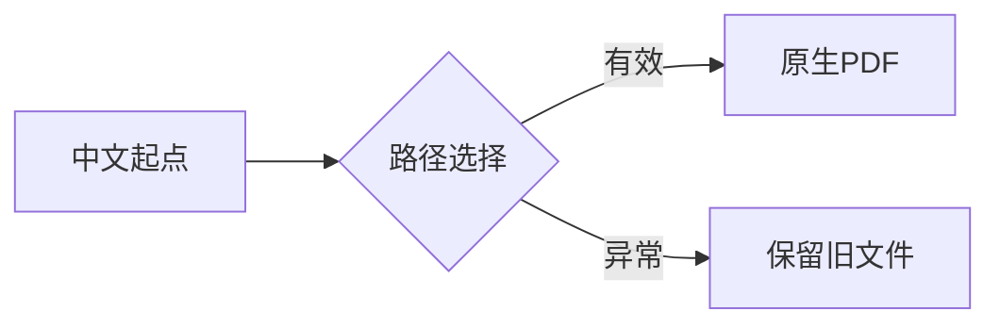
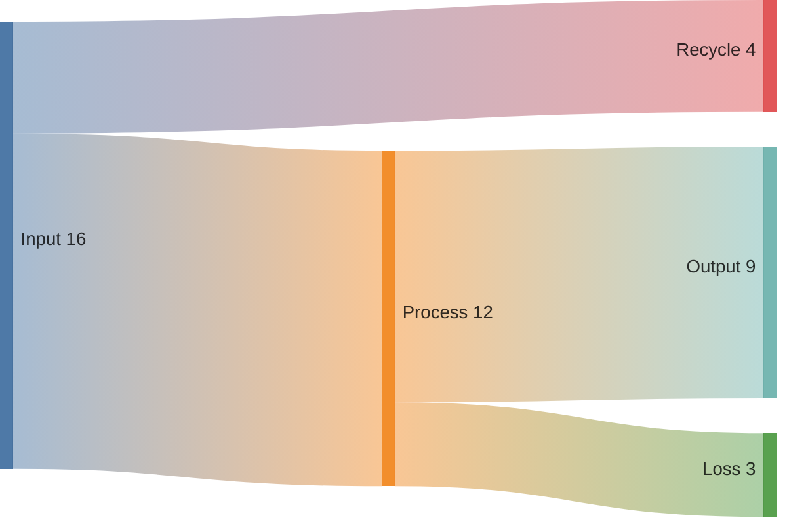

# 原生扩展组合验收

中文正文与公式 $E=mc^2$。大小写重复脚注[^Case]和再次引用[^case]，另一条脚注[^SECOND]。

## 流程图：原生导出

## Sankey：流量与分支

## 五类提示块

> [!NOTE]
> NOTE提示内容：组合文稿说明。

> [!TIP]
> TIP提示内容：保留图形与中文。

> [!IMPORTANT]
> IMPORTANT提示内容：输出完整文稿。

> [!WARNING]
> WARNING提示内容：失败不能覆盖旧文件。

> [!CAUTION]
> CAUTION提示内容：外部资源不开放。

| 组合项目 | 验收值 |
| --- | --- |
| 中文表格 | 42 |
| 本地图片 | 已嵌入 |

$$
\int_0^1 x^2 dx = \frac{1}{3}
$$

[^case]: 大小写归一脚注第一段，含 **格式**。

    这是脚注第二段，必须进入原生PDF。

[^second]: 另一条脚注定义。

[^unused]: 未引用定义也要进入原生PDF。

组合结束标记 EXTENSIONEND。
